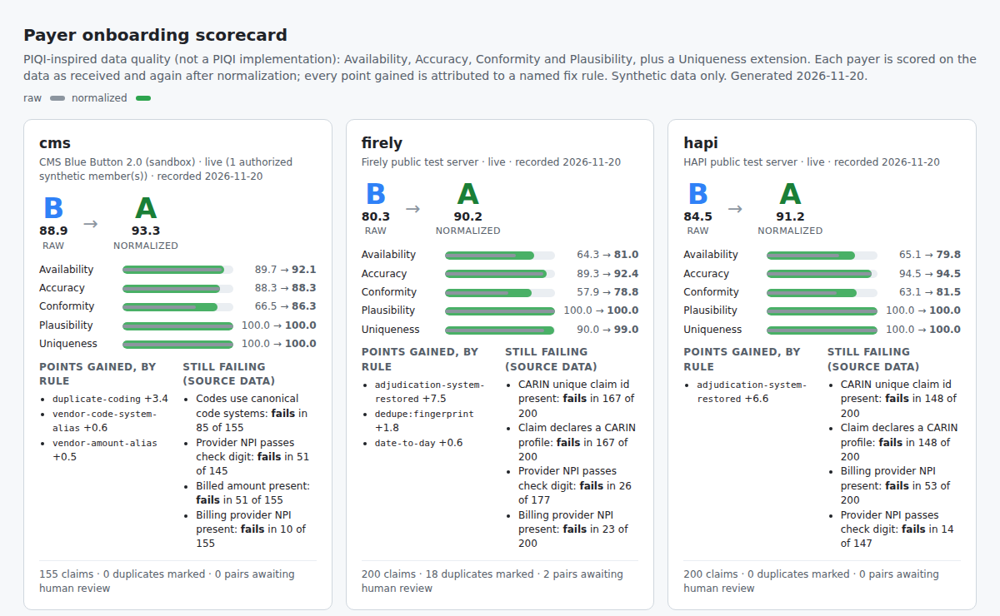

# payer-onboard

Onboard a FHIR payer API (CARIN Blue Button) **by configuration, not code**. Give it a base URL and it:

1. **discovers** what the payer *claims* (CapabilityStatement, SMART auth) and compares that with what the CARIN implementation guide requires;
2. **probes** what the payer *actually does*: it records claims, patients and coverage, and tests the claim searches the CARIN guide requires (all but `_id`, which `read` covers) with a negative control;
3. **normalizes** the data into canonical claims and members, links people across sources deterministically, and marks duplicate claims;
4. **scores** data quality before and after normalization and attributes every point gained to a named rule.

Payer quirks become config suggestions that a person accepts. Synthetic data only.



## How it works


1. **Onboard** (live, per payer): `discover` → `auth` → `probe`, which records scrubbed data and suggests overrides that a person applies with `accept`.
2. **Configure**: four layers merge leaf by leaf into the effective config that the probe and normalizer read.
3. **Normalize and score** (offline, deterministic, no LLM): canonical claims and members, dedupe and linking, SQLite, and a reconciled before/after scorecard.

## Why

A consumer health app has to connect to hundreds of payers. CMS's interoperability rule (CMS-9115-F) requires them to publish a FHIR API for claims data, and CARIN Blue Button is the implementation guide CMS recommends for it. In practice every payer deviates in its own way, and each deviation usually costs hand-written code. This tool turns those deviations into **evidence and config**: what the payer claims, what it really does, and the smallest configuration that makes it work.

## What it found on three real servers

The same code was run against CMS's Blue Button 2.0 sandbox (live, through SMART on FHIR OAuth with PKCE, as a synthetic Medicare member) and the public HAPI and Firely FHIR servers.

| EOB search (CARIN SHALL) | CMS | HAPI | Firely |
|---|---|---|---|
| by patient | ❔ **unverified**: only a bare id works, and with one member on the token a filter can't be told from no filter | ✅ | ✅ |
| `_lastUpdated` (incremental sync) | ✅ | ✅ | ✅ |
| by type | ✅ only with CMS's own codes | ❌ 400 | ⚠️ **silently ignored** |
| by identifier | ⚠️ **silently ignored** | ✅ | ✅ |
| service-date | ✅ only as a `ge`/`le` range | ❌ 400 | ⚠️ **silently ignored** |
| service-start-date, billable-period-start | ⚠️ **silently ignored** | ❌ 400 | ⚠️ **silently ignored** |
| claims carrying a CARIN profile | 155/155 | 52/200 | 33/200 |
| CapabilityStatement declares CARIN | no | no | no |

- **Claims and behavior disagree in both directions.** No server declares CARIN, yet CMS's data is 100% CARIN-profiled. Firely accepts filters it doesn't support and returns all 1,590 claims anyway. A positive-only test can't catch that, because the unfiltered first page can match the filter by chance. Every check therefore runs a **negative control**: a value that cannot match must return nothing. A control that *errors* proves nothing, so the probe falls back to the server's own `Bundle.total` (CMS's `type` filter cut 155 claims to 1) and otherwise reports **unverified** rather than guessing.
- **"Rejected" often means "wrong dialect."** CMS returns 403 for `patient=Patient/<id>` and accepts `patient=<id>`. The probe tries the spec form first, then common variants, and *suggests* the working one as config.
- **The test data contains deliberate traps.** One public dataset holds the same 20 people in two source EHRs, linked by a master patient index id. Most of their claims dedupe cleanly. Two pairs carry NPIs that fail the check digit and a $9,999 sentinel bill. Those two go to a **human-review queue**, not an automatic merge.

### Scorecard

<!-- generated by `npm run demo` (reports/scorecard.md) -->
| Payer | Claims | Raw | After normalization | Change | Top contributors |
|---|---:|---:|---:|---:|---|
| cms | 155 | 88.9 (B) | 93.3 (A) | +4.4 | duplicate-coding +3.4, vendor-code-system-alias +0.6, vendor-amount-alias +0.5 |
| firely | 200 | 80.3 (B) | 90.2 (A) | +9.9 | adjudication-system-restored +7.5, dedupe:fingerprint +1.8, date-to-day +0.6 |
| hapi | 200 | 84.5 (B) | 91.2 (A) | +6.7 | adjudication-system-restored +6.6 |

The dimensions are inspired by [PIQI](https://resources.icanbwell.com/part-1-the-missing-metric-in-healthcare-ai-and-why-data-quality-scores-matter/): Availability, Accuracy, Conformity and Plausibility, plus a Uniqueness extension. **This is not a PIQI implementation**, and the numbers are not comparable to PIQI scores. It runs 16 structural checks per claim.

**How the score is kept honest.** The normalizer doesn't grade itself. Two observers evaluate each of the 15 field-level checks independently of the fix log: one reads the FHIR exactly as the payer sent it, the other reads the normalized row. (They share the definitions, such as the alias tables and the NPI check digit, so a wrong alias would score as wrong on both sides. Uniqueness comes from the dedupe tables, not a second observer.) Reconciliation then requires every fail-to-pass change to be explained by a logged fix rule allowed to cause it, fails on any regression, and checks that the points credited to each rule add up to the measured change. Mutation tests plant one known defect at a time in clean FHIR and assert it is seen, fixed and credited to the right rule, and that an unlogged fix is caught. Normalization never fills in missing values: an absent claim id scores the same before and after. One rule does infer something, and it carries most of the Firely and HAPI gains: `adjudication-system-restored` adds the code system to an amount category that has only a code (`submitted`, `benefit`), when that code is defined in exactly one standard system. It counts in Conformity and again in Availability, because it is what makes the billed amount readable.

## Quick start

Node 24+ is required (it runs the TypeScript directly). There is one runtime dependency.

```sh
npm install
npm run demo        # offline: normalize + score the committed recordings
npm test            # 45 tests
```

Onboard a payer live:

```sh
node src/cli.ts discover hapi --url https://hapi.fhir.org/baseR4 --name "HAPI public test server"
node src/cli.ts explain hapi     # effective config, and which layer set each value
node src/cli.ts probe hapi       # record data, test searches, suggest overrides
node src/cli.ts accept hapi      # a person applies the suggestions
node src/cli.ts normalize && node src/cli.ts score
```

For payers behind OAuth (CMS), put `PAYER_CMS_CLIENT_ID` and `PAYER_CMS_CLIENT_SECRET` in `.env.local`, then run `node src/cli.ts auth cms --member BBUser00000`. It runs the SMART authorization-code flow with PKCE, using the endpoints discovery found. Tokens go to `.tokens/`, which is gitignored. Without a token, CMS falls back to CMS's published synthetic sample.

## How config works

Four layers merge leaf by leaf, and `explain` shows which one set each value:

| Layer | Source | Example |
|---|---|---|
| **spec** | generated from the CARIN IG's own CapabilityStatement | EOB `service-date` search is SHALL |
| **vendor** | a short YAML file per server product | CMS spells HCPCS three ways; total charges use a CMS variable |
| **payer** | written by `discover` | auth endpoints, supported searches, gaps |
| **overrides** | accepted probe suggestions and hand edits; they survive rediscovery | `patient: bare-id`, client-side filtering for ignored params |

Onboarding a new payer that runs a known server product means: `discover`, `probe`, review the suggestions, `accept`. No code.

### Example: CMS Blue Button

Everything CMS-specific is in two short files. The vendor layer, [`vendors/cms-bfd.yaml`](vendors/cms-bfd.yaml), is written once per server product and reused by every payer that runs it:

```yaml
vendor:
  id: cms-bfd
  match:
    softwareName: "^Blue Button API"
normalize:
  # CMS spells HCPCS three ways; all mean the canonical HCPCS system.
  codeSystemAliases:
    https://bluebutton.cms.gov/resources/codesystem/hcpcs: https://www.cms.gov/Medicare/Coding/HCPCSReleaseCodeSets
    https://bluebutton.cms.gov/resources/variables/hcpcs_cd: https://www.cms.gov/Medicare/Coding/HCPCSReleaseCodeSets
  # Institutional claims carry total charges under a CMS variable, not adjudication "submitted".
  amountAliases:
    billed:
      - https://bluebutton.cms.gov/resources/variables/clm_tot_chrg_amt
```

The payer file, [`payers/cms.yaml`](payers/cms.yaml), is written by `discover`. Its `overrides:` block is what `probe` suggested and a person applied with `accept cms`:

```yaml
overrides:
  searchVariants:
    ExplanationOfBenefit:
      patient: bare-id            # Patient/<id> returns 403
      type: code-only:https://bluebutton.cms.gov/resources/codesystem/eob-type
      service-date: prefixed-range  # needs ge/le
  clientSideFilter:             # accepted but silently ignored by the server
    - identifier
    - service-start-date
    - billable-period-start
```

`explain cms` shows the merged result and where each value came from (excerpt):

```text
baseUrl                                    "https://sandbox.bluebutton.cms.gov/v2/fhir"  ← payer
rateLimit.requestsPerSecond                2                                              ← spec
normalize.amountAliases.billed             ["https://bluebutton.cms.gov/resources/..."]   ← vendor
searchVariants.ExplanationOfBenefit.patient "bare-id"                                     ← override
clientSideFilter                           ["identifier","service-start-date",...]        ← override
```

HAPI's and Firely's vendor files hold only notes (no normalization rules), and their only overrides are client-side filters for the searches they reject or ignore.

## Design choices

- **No LLM at runtime.** Coding agents helped build it, but onboarding itself is deterministic and auditable, as it should be for health data.
- **Recordings, not live reads, are scored.** The public test servers accept writes from anyone.
- **Members link only on a shared identifier** (same system and value). There is no name or date-of-birth matching.
- **Dedupe is conservative.** Same payer plus CARIN unique claim id; otherwise a fingerprint that requires a valid NPI and a procedure code, and never merges two claims a payer gave different ids. A missed duplicate beats a false merge; the middle band goes to `review`. Duplicates are marked, never deleted, and the surviving copy keeps the most restrictive confidentiality label and every sensitivity tag (e.g. 42 CFR Part 2) of its twins.
- **Published data is scrubbed, and the scrub fails closed.** A patient without a synthetic marker is reduced to an allowlist (id, gender, birth year, hashed identifiers). Any claim or Coverage whose member isn't a recorded, marked synthetic patient (including members past the 50-patient fetch cap) loses reference display names, contained person resources, addresses, accident details, extensions, free text and member ids; coded billing content and the provider stay. Identifier hashes are unsalted and truncated: enough to stop casual reading of test data, not a de-identification standard.

Every decision, every time the coding agent's first answer was wrong and how it was caught, and what an independent review by a second model found, is in [DECISIONS.md](DECISIONS.md).

## Limitations

- Three sources, one CMS synthetic member. This is a working demonstration, not a certification tool. For formal conformance testing, use ONC's [Inferno CARIN test kit](https://inferno.healthit.gov/test-kits/carin-for-blue-button/). This project targets the step after conformance: onboarding cost and data quality.
- Plausibility has only three checks (date order, future dates, paid ≤ billed). A score of 100 means none failed, not that the data is clinically plausible.
- Some checks are consistency choices, not spec violations. Listing one ICD-10 code under both `icd-10-cm` and `icd-10` is legal FHIR; it is scored because downstream counts double, and it accounts for most of CMS's gain. A timestamp in `billablePeriod` is also legal; normalizing it to a day is likewise a consistency choice.
- The check set is mine, not a validated instrument. Changing which checks exist changes the scores; the reconciliation proves the arithmetic and attribution, not that these are the right checks.
- There is no sync worker. The output is the evidence, the config a worker would read, and the normalized store.

## License

Apache-2.0. Built by [Jeff Hoffman](https://jefferyhoffman.dev) with an AI coding agent; the decisions are his and are logged in DECISIONS.md.
